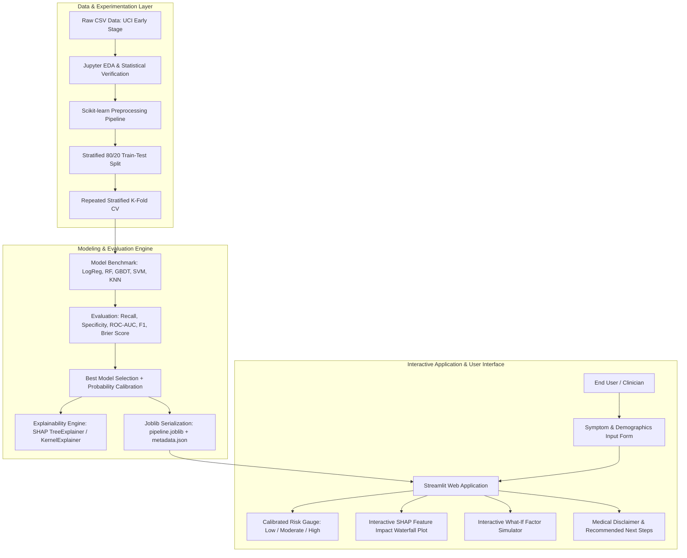

# Project Specification & System Architecture
## Predictive Analytics for Early Type-2 Diabetes Risk Detection Using Machine Learning

---

## 1. Project Overview & Requirements Summary

| Parameter | User Specification | Technical Adaptation |
| :--- | :--- | :--- |
| **Timeline** | 1–2 Weeks | Rapid, focused milestones with strict separation of concerns and high automation |
| **Experience Level** | Advanced | Rigorous statistical grounding, production-grade Scikit-learn pipelines, XAI (SHAP), clean OOP code |
| **Target Quality** | Portfolio / Top-tier College Final Year Project | Reproducible seed control, data-leakage guards, unit tests (pytest), model calibration, interactive UI |
| **Environment** | Python `venv` | Clean virtual environment without global pollution |
| **Architecture** | High-ROI Architecture Recommended | **Modular Python Core (`src/`) + Streamlit Dashboard**. This gives production-grade modularity (easily exposed to FastAPI if needed) while providing rich, interactive clinical explainability and what-if simulation within 1–2 weeks. |

---

## 2. Dataset Comparative Analysis

| Dimension | Candidate 1: UCI Early Stage Diabetes Risk | Candidate 2: Pima Indians Diabetes Database (PIDD) | Candidate 3: CDC BRFSS Diabetes Survey (2015) |
| :--- | :--- | :--- | :--- |
| **Origin / Source** | Sylhet Diabetes Hospital, Bangladesh (Islam et al., 2020) via UCI ML Repo | National Institute of Diabetes and Digestive and Kidney Diseases (NIDDK) via UCI | Centers for Disease Control and Prevention (CDC) Behavioral Risk Factor Surveillance |
| **Target Population** | Male and female outpatients (Ages 20–65) | Exclusively females $\ge 21$ yrs of Pima Indian heritage (Phoenix, AZ) | General US adult population (phone interview self-reports) |
| **Sample Size** | 520 instances, 17 variables | 768 instances, 9 variables | 253,680 (or 70,692 balanced subset) |
| **Nature of Features** | **Symptom & Sign Questionnaire**: Polyuria, Polydipsia, sudden weight loss, weakness, polyphagia, genital thrush, visual blurring, itching, irritability, delayed healing, partial paresis, muscle stiffness, alopecia, obesity, age, gender. | **Clinical Laboratory Measurements**: Pregnancies, Glucose (OGTT 2h), Diastolic BP, SkinThickness (triceps), Insulin (2h serum), BMI, Diabetes Pedigree Function, Age. | **Broad Behavioral / Survey**: HighBP, HighChol, Smoker, Stroke, HeartDiseaseorAttack, PhysActivity, Fruits, Veggies, HvyAlcoholConsump, GenHlth, MentHlth, PhysHlth, DiffWalk, Sex, Age, Education, Income. |
| **Missing Values / Data Anomalies** | Zero missing values in official UCI release. Discrete binary values encoded cleanly. | **Severe Hidden Missingness**: Biologically impossible zeros in `Glucose` (5), `BloodPressure` (35), `SkinThickness` (227 ~30%), `Insulin` (374 ~49%), and `BMI` (11). | Missingness handled by CDC weighting; survey response bias and self-reporting noise. |
| **Suitability for Early Risk Screening App** | **Extremely High**: Accessible to anyone without visiting a pathology lab or drawing blood. Ideal for symptom-based pre-clinical screening. | **Moderate**: Requires invasive blood draws (fasting/OGTT, insulin assay). If a patient already has a 2h OGTT glucose $\ge 200$ mg/dL, they are clinically diagnosed by WHO criteria, defeating the purpose of pre-screening. | **Moderate**: Broad lifestyle factors, but less specific to early acute diabetic symptoms. Huge data volume increases training overhead unnecessarily for a 1-2 week timeline. |

### Final Recommendation: UCI Early Stage Diabetes Risk Dataset
**Justification**:
1. **Clinical Alignment with Early Screening**: Our objective is early risk detection for ordinary individuals before clinical lab tests. A user cannot enter their "2-hour serum insulin" at home, but they can report polyuria, polydipsia, and fatigue.
2. **Demographic Inclusivity**: Covers both adult males and females across age brackets (20–65), avoiding the severe demographic confinement of PIDD (exclusively Pima females).
3. **Data Integrity & Signal-to-Noise**: High clinical fidelity directly recorded by clinicians using validated questionnaires at Sylhet Diabetes Hospital, with zero corrupt zero-encoded values.

*(Note: We can also keep PIDD as a secondary comparative validation case study in the project report to demonstrate our deep understanding of laboratory diagnostic predictive modeling).*

---

## 3. High-Level System Architecture

---

## 4. Phase-by-Phase 1–2 Week Roadmap

- **Phase 1 (Day 1)**: Requirements specification, architecture design, directory scaffolding, `venv` setup.
- **Phase 2 (Day 2)**: Dataset ingestion, checksum verification, source documentation.
- **Phase 3 (Day 3)**: Rigorous Exploratory Data Analysis (EDA) — distributions, chi-square tests of independence, correlations, report generation.
- **Phase 4 (Day 4)**: Pipeline design — leak-free Scikit-learn transformers, stratified splitting, encoding.
- **Phase 5 & 6 (Days 5–6)**: Model training, tuning, benchmarking (Logistic Regression, Random Forest, LightGBM/GradientBoosting, SVM, KNN), threshold optimization prioritizing **Recall (Sensitivity)** to minimize False Negatives, and probability calibration.
- **Phase 7 (Day 7)**: Explainable AI (XAI) using SHAP (Global summary and local waterfall explanations).
- **Phase 8 (Days 8–9)**: Streamlit web application build with interactive UI, risk categorization, SHAP visualizations, and medical disclaimers.
- **Phase 9 (Day 10)**: Pytest unit tests, code linting, environment freeze (`requirements.txt`), and deployment preparation (Streamlit Community Cloud or local Docker/portable runner).
- **Phase 10 (Days 11–12)**: Academic report drafting, viva questions & answers, presentation slides, demonstration plan.
