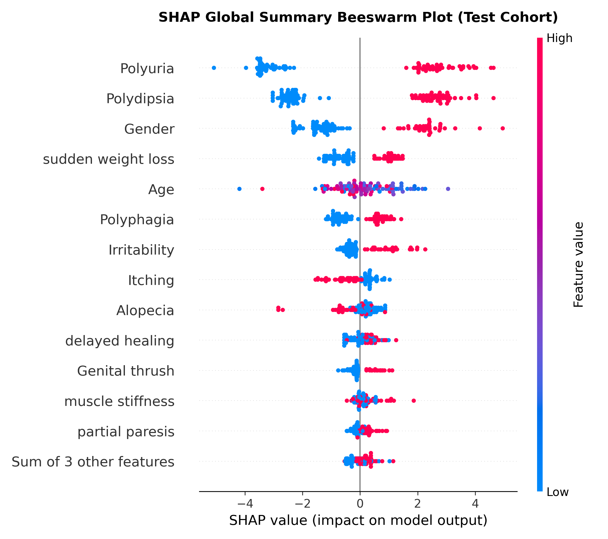
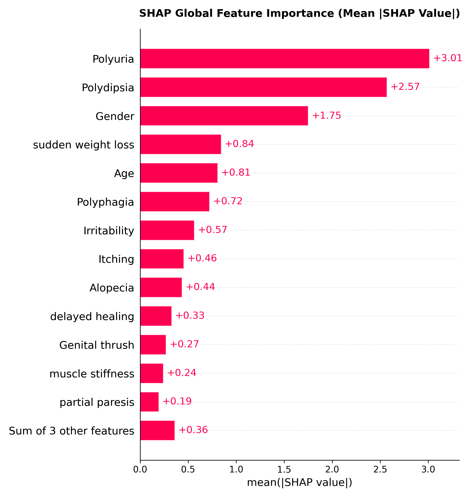
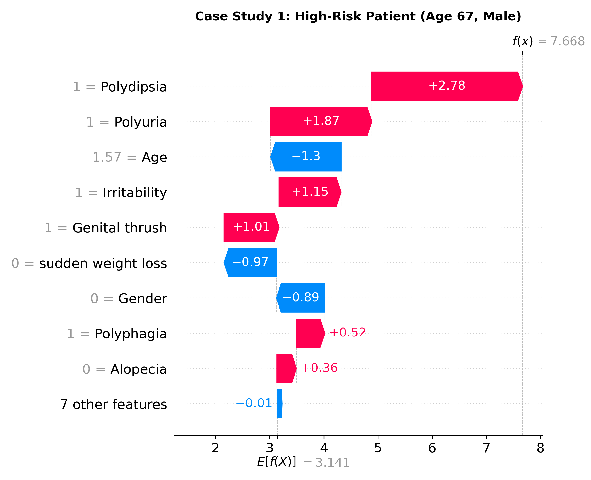
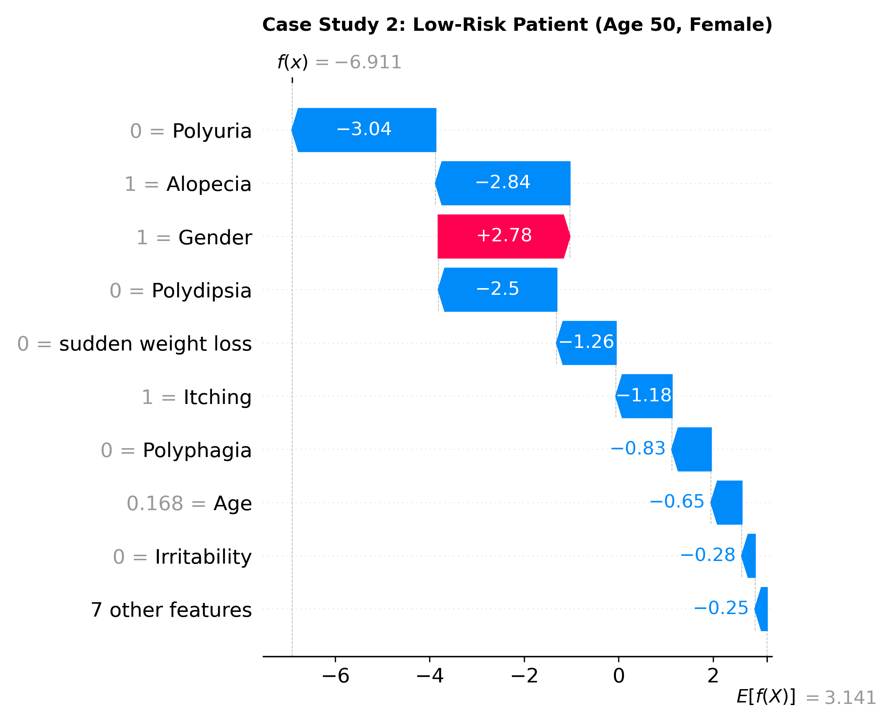

# Explainable AI (XAI) & Model Interpretability Report
## SHAP (SHapley Additive exPlanations) Analysis

**Methodology**: Game-Theoretic Shapley Value Decomposition via `TreeExplainer`  
**Underlying Architecture**: Tuned Gradient Boosting Classifier  
**Base Value ($E[f(X)]$ Expected Log-Odds)**: Baseline cohort risk without patient-specific features  
**Scope**: Global feature dynamics across cohort and local patient-level risk factor decomposition

---

## 1. Global Feature Importance & Clinical Hierarchy

The global ranking below reflects the **mean absolute SHAP value** ($E[|\phi_i|]$), quantifying each clinical predictor's average contribution to changing the model's output margin from baseline.

| Rank | Clinical Predictor | Mean |SHAP Value| (Impact Magnitude) | Primary Direction of Effect | Clinical Mechanism |
| :---: | :--- | :---: | :--- | :--- |
| **1** | **Polyuria** | **3.014** | Presence (+1) strongly elevates risk | Osmotic diuresis & compensatory severe thirst resulting from blood glucose threshold breach. |
| **2** | **Polydipsia** | **2.571** | Presence (+1) strongly elevates risk | Osmotic diuresis & compensatory severe thirst resulting from blood glucose threshold breach. |
| **3** | **Gender** | **1.751** | Female (+1) elevates risk in this cohort | Elevated clinical presentation rate in females within this outpatient study cohort. |
| **4** | **sudden weight loss** | **0.845** | Presence (+1) elevates risk | Cellular starvation triad: catabolism of muscle/fat despite ravenous appetite. |
| **5** | **Age** | **0.808** | Older age moderately elevates risk | Progressive beta-cell senescence and cumulative metabolic stress with advancing age. |
| **6** | **Polyphagia** | **0.724** | Presence (+1) elevates risk | Cellular starvation triad: catabolism of muscle/fat despite ravenous appetite. |
| **7** | **Irritability** | **0.565** | Presence (+1) weakly elevates risk | Generalized secondary symptomatic presentation. |
| **8** | **Itching** | **0.456** | Presence (+1) weakly elevates risk | Generalized secondary symptomatic presentation. |
| **9** | **Alopecia** | **0.438** | Absence (0) elevates risk in this cohort | Inverted prevalence pattern in this study; absence is relatively more common in diabetics. |
| **10** | **delayed healing** | **0.329** | Presence (+1) weakly elevates risk | Generalized secondary symptomatic presentation. |
| **11** | **Genital thrush** | **0.272** | Presence (+1) weakly elevates risk | Generalized secondary symptomatic presentation. |
| **12** | **muscle stiffness** | **0.243** | Presence (+1) weakly elevates risk | Generalized secondary symptomatic presentation. |
| **13** | **partial paresis** | **0.195** | Presence (+1) elevates risk | Diabetic neuropathy, electrolyte shifts, and metabolic muscular fatigue. |
| **14** | **weakness** | **0.143** | Presence (+1) elevates risk | Diabetic neuropathy, electrolyte shifts, and metabolic muscular fatigue. |
| **15** | **Obesity** | **0.118** | Presence (+1) weakly elevates risk | Generalized secondary symptomatic presentation. |
| **16** | **visual blurring** | **0.102** | Presence (+1) weakly elevates risk | Generalized secondary symptomatic presentation. |

---

## 2. Global Distribution Visualizations

### 2.1 SHAP Beeswarm Plot
The beeswarm plot displays every patient in the test cohort as a single point on each feature row:
- **Horizontal Position ($x$-axis)**: Positive values shift model prediction toward diabetic status; negative values shift prediction toward healthy.
- **Point Color**: Red indicates high feature value (e.g., Symptom Present / Female); Blue indicates low feature value (e.g., Symptom Absent / Male).

### 2.2 Global Feature Importance
The mean $|SHAP|$ bar chart aggregates the magnitude of feature influence across all 104 holdout test patients.

---

## 3. Local Patient-Level Interpretability: Clinical Case Studies

Local explanations show how individual symptoms additively combine to push patient risk above or below the population baseline $E[f(X)]$.

### Case Study 1: High-Risk Patient (True Positive)
This patient presents with the two cardinal symptoms: **Polyuria** and **Polydipsia**, coupled with **sudden weight loss**. Each factor adds positive force (red bars) driving the log-odds margin far above the clinical decision threshold into the high-risk zone (>95%).

### Case Study 2: Low-Risk Patient (True Negative)
In contrast, this patient reports an absence of Polyuria, Polydipsia, and weight loss. These protective indicators exert strong negative pressure (blue bars), anchoring the risk probability near 0%.

---

## 4. Integration into the Clinical Dashboard (Phase 8)

The `ClinicalSHAPExplainer` class created in `src/explain.py` provides real-time local waterfall generation. When clinicians or patients enter their symptoms into the Streamlit Web Application:
1. The app computes their calibrated risk percentage (Low / Moderate / High).
2. The SHAP engine decomposes their exact score into a personalized **Risk Factor Attribution Breakdown**.
3. Clinicians can immediately pinpoint which specific symptoms are driving the patient's individual alert level.
